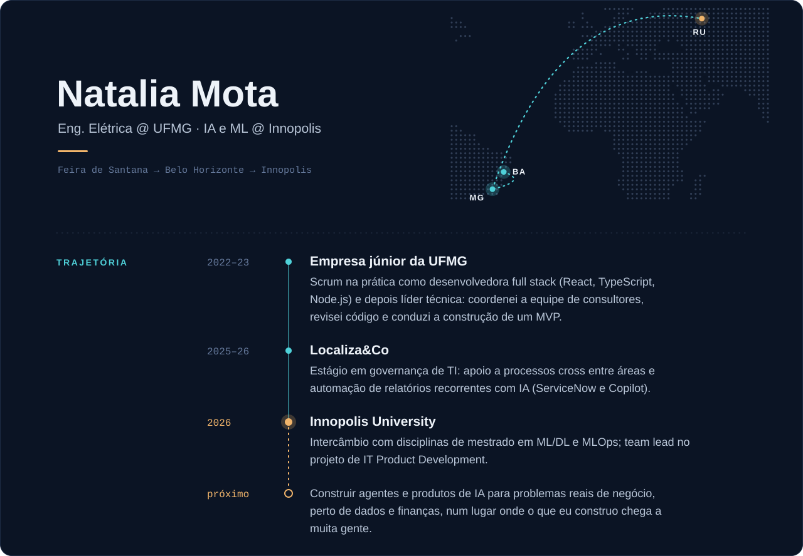

  <a href="https://github.com/nataliamotand/comanda">Comanda · repositório</a> &nbsp;·&nbsp;
  <a href="https://v0-comanda-dashboard.vercel.app">Dashboard ao vivo</a> &nbsp;·&nbsp;
  <a href="https://www.linkedin.com/in/natalia-mota-35b93425a">LinkedIn</a> &nbsp;·&nbsp;
  <a href="mailto:ndsmota@gmail.com">ndsmota@gmail.com</a>

