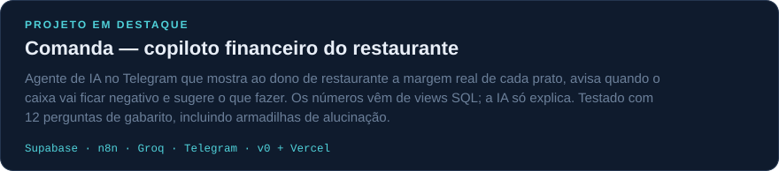

Estudante de Engenharia Elétrica na UFMG, em intercâmbio na Innopolis University (Rússia), cursando disciplinas de mestrado em IA e Machine Learning. Projetos com LLMs, agentes, automação e dados.

#### Outros projetos

#### Ferramentas

#### Contato

&nbsp;

